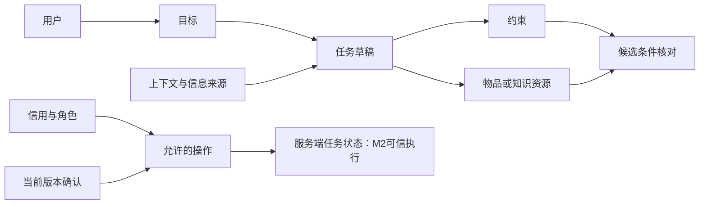
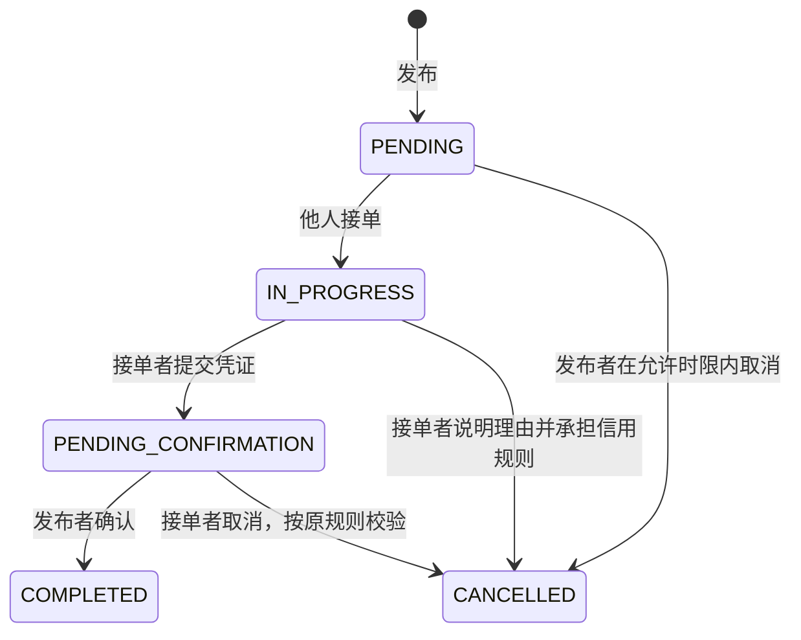

# 02 业务本体、个人上下文与操作边界

依据课件第7页，关联老师项目源码；机器可读定义见 [ontology.json](./ontology.json)。状态和字段须区分“现有系统事实”“M1原型新增”“M2待落地”，不把候选理解当授权。

## 1. 共同概念与关系

| 概念 | 含义 | 当前项目对应与边界 |
| --- | --- | --- |
| 用户 User | 表达需求和承担业务责任的人 | User；发布者/接单者/管理员依具体操作确定 |
| 目标 Goal | 用户希望完成的事情 | 现有title/description；M1进一步表达四类目标 |
| 资源 Resource | 可用于满足目标的物品、知识或时间 | 没有独立物品库存；物品是否可借不能猜 |
| 约束 Constraint | 时间、地点、规格、方式和权限限制 | expectedTime/location覆盖有限；M1新增多时间点与特殊要求 |
| 任务 Task | 可发布和执行的互助需求 | Demand同时承载发布和执行状态，没有旧项目独立订单表 |
| 匹配 Match | 判断候选资源或协助方式是否满足约束 | M1只比较请求条件和沟通方式，不声称有真实推荐人员 |
| 信用 Credit | 影响发布/接单等资格的服务端规则 | User.creditScore/restrictedUntil；不能由模型自行加减 |
| 授权 Authorization | 当前用户对明确操作和参数的确认 | M1是本地草稿版本；M2需要服务端确认与审计 |
| 上下文 Context | 当前问题、已知事实与待确认信息 | M1内存字段与对话；不是永久用户记忆 |
| 操作 Operation | 澄清、修改、确认、发布、接单等 | 只允许已定义动作，执行权限来自系统 |

## 2. 四类业务专属概念

**BORROW物品借用**：物品、用途、数量、规格/兼容要求、配件、使用说明、使用限制、最晚拿到、使用起止、归还时间、出借方明确归还期限、取还位置、交接方式、协商条件。

原型里的“待与出借方协商”是请求条件，不表示对方已同意；用户输入“已获同意（设计输入）”也仅作为设计样本声明。没有库存、借出承诺或正式借贷契约。

**STUDY学习辅导**：问题上下文、知识点、卡住步骤、讲解起点、优先问题、可用时间、沟通方式、解释语言、是否解决。普通短消息不要求先发布；标记解决只记录用户声明。

**RUNNING跑腿代办**：代办类型、物品、数量、取件点、送达点、取件开始、最晚送达、交接方式、具体放置点、通知、完成确认方式、语言、搬运/等待限制、代买预算。预算不是支付凭证；交付凭证是约定类型，M1没有上传或核验真实照片。

**OTHER其他互助**：协助类型、目标、必要资源、时间区间、服务位置或联系渠道、沟通方式、完成标准、授权条件、人数及组织方式。待授权是请求条件，不是执行许可。现有任务只对应一个接单者；多人协助仅提出拆分单人任务或一人协调方案，M1不改生产结构。

**业务路由 BusinessRoute**：用户目标→候选类别→用户选择→领域草稿。AUTO是原型入口状态，不是第五类生产业务。未知和混合输入不能直接发布。**保留草稿 SuspendedDraft**保存各业务字段与消息；恢复使旧确认失效。规则推测不变为事实。

借用结束与归还确认的生产语义目前尚未独立实现。M1可以设计完整借还约定，不能把现有提交完成凭证自动描述成已有的物品归还验收系统。

## 3. 字段和接口映射

| 原系统字段/API | 已有含义 | M1使用方式 |
| --- | --- | --- |
| title / description | 发布标题和描述 | 可生成派生草稿，用户能修改并核对；不是凭空补事实 |
| category | 前端四类；后端目前字符串 | 使用BORROW/STUDY/RUNNING/OTHER，不用旧分类；后端类别白名单是技术债 |
| expectedTime | 单个期望完成时间 | 发布时用户明确填写；不能替代多段借期 |
| reward | 正数报酬 | 发布前校验>0；不自动填0，无偿发布留待升级 |
| location | 服务位置 | 发布前用户明确填写；不能擅自将“线上”或取件点当默认值 |
| POST /api/demands | 真实发布 | 原型只显示参数预览，不发送 |
| PUT /api/demands/{id}/accept | 接单 | 禁自接、状态和信用检查已存在；并发一致性需补 |
| /complete、/confirm | 接单者提交，发布者确认 | 现有角色/状态校验，不是M1模拟确认 |
| /cancel | 取消 | 受原系统状态、角色、30分钟等规则限制 |
| /api/messages | 已有任务的双方聊天 | 不等于AI助手会话；M1发布前上下文独立模拟 |
| /api/appeals | 信用/封禁申诉 | 不等于普通人工接管客服 |

M1不会改生产DTO、数据表或API。新增字段在原型内存中存在；将它们持久化、映射到真实工具和确认契约属于M2。

## 4. 状态机与已有规则

源码事实：发布者只能取消未接单且发布不超过30分钟的需求；接单者取消进行中/待确认需求需理由，扣5信用分。信用<40禁止发布和接单；信用<60且restrictedUntil尚未到期时限制发布。4—5星评价+1，1—2星-3。管理员审批申诉有独立角色检查。上述是现有实现，不表示这些政策已通过真实用户合理性验证。

原型状态为clarifying、ready、confirmed、cancelled、handed_off、resolved，与后端状态分开。confirmed只表示某版本本地草稿经过模拟确认；刷新会清空。重复确认同一版本不新建记录；修改或撤销旧版本后重新确认。

## 5. 对话和确认规则

| 编号 | 规则 | 本阶段证据 |
| --- | --- | --- |
| R01 | 缺少必要事实时追问，不补库存、地点或对方承诺 | B01/B03及未知字段测试 |
| R02 | 规格保留可核实要求，实际适配能力仍须核实 | B01草稿卡说明 |
| R03 | 拿到≤使用开始<使用结束≤归还 | 日期、逆序与跨天测试 |
| R04 | 明确归还硬期限不能自行延长 | returnDeadline冲突测试 |
| R05 | 取还位置要可识别；交接方式变更重确认 | 模糊位置、切换、旧确认失效 |
| R06 | 初次使用增加说明与配件澄清 | B04区别于普通借用 |
| R07 | 学习只追问当前理解所需的信息 | L05没有发布字段与确认卡 |
| R08 | 连续追问沿用上下文，用户纠正覆盖当前字段 | 表达式保留和修改测试 |
| R09 | 只有主动准备发布才需要原系统字段 | 缺报酬/时间/位置阻止模拟发布 |
| R10 | 确认绑定当前字段快照与版本，修改使旧确认失效 | 快照、同值重选、撤销测试 |
| R11 | 撤销/解决/接管是用户操作；结束后不能继续执行 | 终态拦截与重置测试 |
| R12 | 降级可回固定表单；人工接管明确模拟 | 浏览器真实操作和无外部请求检查 |
| R13 | 取件开始早于最晚送达，放置交付要求具体位置及匹配的完成确认方式 | RUNNING时间/交接测试 |
| R14 | 静默约束不能配电话通知；搬运能力与语言仍需核实 | R01/R02/R04 |
| R15 | OTHER需要可核对的范围、完成标准、时间、资源和授权条件 | O01—O05 |
| R16 | 多人协助须明确组织方式；模拟拆分不是生产批量执行 | O02、拆分预览 |
| R17 | 类别只是候选，确认前不能切换或发布；混合目标分开处理 | 统一入口及跨业务测试 |
| R18 | 恢复业务草稿不得复用旧确认；新业务不继承旧领域字段 | 草稿恢复测试 |
| R19 | 发布标题/描述为派生草稿时随业务字段更新；用户手写说明保留 | 发布描述同步测试 |

## 6. 个人上下文与责任

| 信息 | 来源/性质 | 修改与保留 |
| --- | --- | --- |
| 场景预填值 | design_sample，设计假设 | 不伪装成访谈；用户可修改 |
| 用户填写 | user_declared，当前任务声明 | 与原话关联，可纠正 |
| 标题/描述草稿 | derived_draft，规则整理候选 | 可编辑，需核对后确认 |
| 资源可用、对方同意 | 未知或用户声明，不能凭推测确认 | 卡片明确核实/协商边界 |
| 当前借期、地点、可用时长 | 临时情境 | 重置/刷新清空，不存浏览器数据库 |
| 语言或讲解偏好 | 本次声明 | 不自动升级为长期画像 |
| 后端信用和真实任务 | 服务端事实 | 原型不改信用，不伪造任务状态 |

原型不收集真实手机号、取件码、学号、身份证或支付信息。对话和字段不发送给模型；原平台自己的JWT/localStorage行为与这个原型分开。M2需要实现服务端授权、可撤回记忆及数据保留策略。

## 7. 四业务与真实生命周期的衔接

四类发布均映射到Demand的title/description/category/expectedTime/reward/location，沿用同一状态机与信用规则，不另造EXPRESS或TUTORING接口。

| 业务 | 发布前个性化条件 | 接单前待核对 | 提交完成与发布者确认的设计含义 |
| --- | --- | --- | --- |
| BORROW | 规格、借期、取还与限制 | 物品适用、是否可借、双方约定 | 明确取借与归还阶段，不能把取到物品当全部借还完成；M2补充领域阶段 |
| STUDY | 问题、深度、方式、时间 | 协助范围和协作者能力 | 交付讲解/辅导结果，发布者确认；普通聊天的“已解决”不改生产任务 |
| RUNNING | 物品、取送点、时间、交接和通知 | 可执行条件、取件授权 | 按当面/放置约定提交凭证，发布者核对，不能AI代替用户确认 |
| OTHER | 范围、资源、授权、时间、完成标准 | 能力与组织方式 | 按明确完成标准提交结果，发布者确认；拆分的各子任务独立执行 |

以上领域验收是M1设计，现有后端只提供通用完成凭证和确认接口。领域阶段、时间映射、隐私访问和授权契约须M2实现并验证。人工回退复用统一需求摘要，但申诉不是通用客服。取消/评价仍沿用系统规则，不自行消除信用影响。
