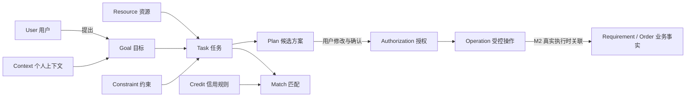
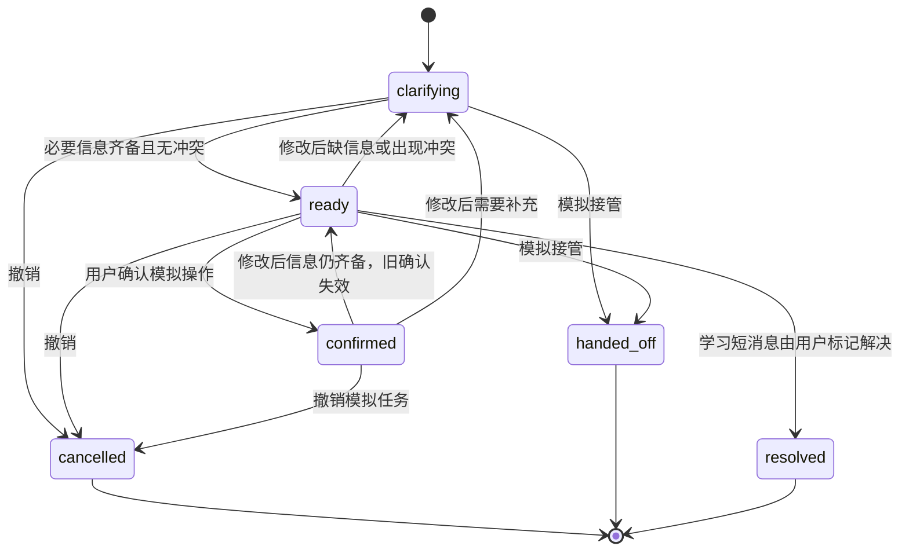

# 03 业务本体、关系与允许操作

本体是可以共同解释业务的概念、关系与规则，并不等同于数据库表。版本：`M1-1.0`。机器可读定义见 [ontology.json](./ontology.json)。

## 1. 共同概念

| 概念 | 含义与关键属性 | 关系 |
| --- | --- | --- |
| User 用户 | 发布方、协助方、管理员角色；原系统 userId | 提出 Goal；授权操作；参与 Task |
| Goal 目标 | 当前想达成的结果，业务类型、成功条件 | 由 Context 与 Constraint 修饰，形成 Task |
| Resource 资源 | 快递、驿站、交接点；题目、表达式、可提供帮助的时间 | 为 Goal 提供对象/条件 |
| Context 个人上下文 | 事实来源、确认状态、有效期；本次能力/语言/时间情境 | 解释 Goal，不能自动固化为人格 |
| Constraint 约束 | 字段、值、硬/软、来源；未确认也可存在 | 限定可行的 Plan |
| Task 任务 | 目标、上下文、版本、状态、当前待补字段 | 生成候选 Plan；可能关联原 Requirement/Order |
| Plan 方案 | 交接或沟通安排，适用条件、未决问题 | 供用户比较、修改和确认 |
| Match 匹配 | 依据允许条件寻找协助资源或人员 | 使用 Task 约束；真实候选匹配留到 M2 |
| Credit 信用 | 原系统履约评价的确定性规则结果 | 不由对话模型任意判定或扣分 |
| Authorization 授权 | 用户、操作、资源范围、确认的参数版本、有效期与撤回 | 允许特定 Operation，不是一次确认无限操作 |
| Operation 操作 | 澄清、修改、确认、发布、预约、撤销、接管 | 具有前提条件、结果与失败语义 |

## 2. 业务专属概念

| 快递概念 | 结构与不变量 |
| --- | --- |
| ParcelBatch 快递批次 | 件数为正整数，原型演示范围1—99；这是原型边界，不是教师规定 |
| PickupPoint 取件点 | 校区与可识别驿站；“北门”不能自动补全校区 |
| Handover 交接 | face 当面 / drop 指定点放置；必须用户明确选择 |
| HandoverPoint 交接点 | 本次可识别位置；切换方式后重新确定 |
| TimeWindow 时间 | 原型采用同日明确时点/窗口；跨日和复杂排程需额外澄清 |
| Notification 通知约定 | 普通 / 静默；描述意图，本阶段不真正推送 |
| CompletionEvidence 完成凭证 | 放置采用照片或位置文字说明，之后由用户确认；照片上传未实现 |
| TemporaryStorage 暂存 | 截止早于交接时，由用户选择提前取件并明确暂存点；不假定已经有保管服务 |

| 学习概念 | 结构与不变量 |
| --- | --- |
| QuestionContext 问题上下文 | 当前题目、表达式、知识点；碎片步骤问题须有具体上下文 |
| StuckStep 卡住的位置 | 某一步或术语；可通过短消息继续定位 |
| ExplanationDepth 深度 | 当前一步 / 必要基础 / 例子；不作为长期能力标签 |
| CommunicationMode 沟通 | 连续消息 / 异步 / 实时预约；用户主动选择 |
| Priority 优先问题 | 时间有限时用户确定，不由模型替用户决定 |
| LearningAction 操作 | conversation / publish / book；普通短消息没有发布确认卡 |
| Resolution 解决反馈 | 用户标记理解；不依据模型自评宣布用户已经学会 |

## 3. 原型字段与状态

`session` 包含 business、values、facts、messages、revision、confirmation、status、learningAction、conflicts、events。前端 values 的字段定义和选项直接导出到 ontology.json，避免文档与代码分叉。

- facts 的 source 表示用户消息中的有限规则识别、用户填写或用户选择；不是语言模型置信度。
- status=explicit 表示存在用户直接表达，不表示已经获得执行授权；执行仍需单独确认。
- revision 是当前约定版本；修改增加版本并清空旧 confirmation。
- confirmation 仅在内存中包含操作、版本和字段快照，生产身份签名/有效期/服务端鉴权尚未实现。

这是原型任务状态，不是原数据库 OrderStatus 的替代。已撤销、已解决、已接管后只能重置开始新临时会话。

## 4. 规则与实现状态

| ID | 规则 | 状态 / 验证 |
| --- | --- | --- |
| R01 | 必要信息未知时追问，不能发布 | 已在规则原型演示并测试 |
| R02 | 两种交接方式同句为候选时不自行选择 | 已测试；复杂否定表达须手动纠正 |
| R03 | 当面需要联络约定；放置需要位置与完成确认 | 已演示并测试 |
| R04 | 地点含糊、时间不具体、非法件数或窗口不能确认 | 有限规则检查；不是地理数据库核验 |
| R05 | 取件截止与交接冲突须用户调整或明确暂存方案 | 已演示并测试；不实际核验驿站/暂存资源 |
| R06 | 修改后确认失效，重复点确认不重复模拟执行 | 已演示并测试；生产幂等键留到 M2 |
| R07 | 普通碎片问题按需补上下文，不要求预算/校区/预约 | 已演示并测试 |
| R08 | 发布求助须明确沟通方式；预约须有具体时段 | 已演示并测试 |
| R09 | 撤销或模拟接管后不可继续执行 | 已演示并测试 |
| R10 | 精确地点、表达式和对话不写入原型事件日志 | 已测试；会话内仍含这些内容，刷新清空 |
| R11 | 不可自接单、评价须已完成订单参与者、信用按规则更新 | 原业务已有部分实现；不由原型执行 |
| R12 | 真实发布/接单须后端鉴权、对象权限、确认、状态与幂等 | M2 待接入；浏览器本地确认不能代替它 |

## 5. 操作契约

| 操作 | 前提 | 结果 / 失败 |
| --- | --- | --- |
| sendMessage / editField | 非终态；字段/选项在定义范围内 | 更新上下文与版本，未知继续追问；不可识别则人工补充 |
| chooseLearningAction | TUTORING；用户选择有效动作 | 发布/预约增加必要字段；返回对话解除预约要求 |
| confirm | 需要副作用确认、ready、无缺失与冲突 | 保存当前版本并产生一个模拟事件；未满足条件返回失败 |
| cancel | 尚未撤销/解决/接管 | 撤销本次模拟；未调用真实取消工具 |
| handoff | 非终态 | 提供业务/缺口/冲突数量的模拟接管摘要；未建立人工工单 |
| resolve | 学习对话、有问题且必要上下文齐备 | 用户反馈解决；不创建订单 |
| reset | 用户确认清空 | 新临时 session；清空消息、参数与确认 |

本阶段无需新增生产 API。后续应将前端字段意图映射到确定性工具契约，并在服务端重新检查所有业务不变量。
