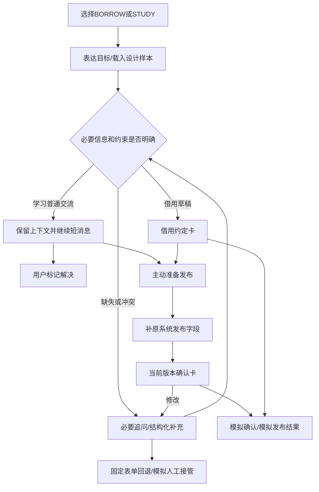

# 03 对话与卡片原型

源码与运行说明见 [prototype](./prototype/README.md)。这是一套Vue有限规则原型，不是鸿蒙客户端、ArkUI Schema Renderer或真实AI服务。JSON契约用于设计衔接，不能作为已完成M2的证据。

## 1. 交互流程

## 2. 十组对话脚本

以下是设计脚本。规则原型可通过样本入口、输入与结构化补充验证关键行为，不承诺能自由理解所有自然语言。示例回答只展示澄清和线索延续，不提供真实数学或设备使用解答。

| 场景 | 用户表达 | 必要追问 | 用户补充及交互结果 |
| --- | --- | --- | --- |
| B01 | 展示要借转接器，不知道接口怎么选 | 电脑和投影是什么接口？未知能力如何核实？ | 补USB-C/HDMI要求；规格进入草稿，资源适配仍待核实 |
| B02 | 19点展示，得提前拿到 | 最晚拿到、结束使用、归还各是什么时间？ | 补具体时间；若拿到晚于使用则风险卡阻止确认 |
| B03 | 行动不方便，希望送到宿舍门厅 | 明确哪栋、哪个位置；出借方同意了吗？ | 选待协商；卡片保留请求性质。变为当面后重新确认接收位置 |
| B04 | 第一次用相机，需要说明 | 需要哪些配件和说明？限制需向谁核实？ | 补充充电器/存储卡请求；不虚构教程或已提供配件 |
| B05 | 借两天，归还时原地点可能不可用 | 完整日期、归还位置和硬期限是什么？ | 明确替代交接请求；超过已知期限须重新协商 |
| L01 | 导数定义也不懂，不知道从哪问 | 希望从极限还是定义开始？ | 选择从基础讲，先明确讲解起点 |
| L02 | 只有20分钟 | 最优先弄懂哪一步？ | 记录优先问题，缩小范围，不将20分钟变成预约时段 |
| L03 | 不方便见面，想发消息问 | 线上异步还是同步？ | 选择线上异步，不强迫线下位置 |
| L04 | derivative看不懂 | 中文、英文还是双语术语？ | 保留原术语与语言选择，不宣称已提供真实翻译 |
| L05 | 第二步到第三步怎么来的 | 只需贴出两步或相关题目 | 补x=-2→-x=2，再问负号；上下文保留，无预算表单 |

## 3. 卡片与控制

| 卡片/区域 | 内容 | 出现条件和允许动作 |
| --- | --- | --- |
| 借用规格与约定 | 用途、规格、数量、时间、取还位置、说明和协商 | BORROW；按情境补字段，用户修改 |
| 风险提示 | 地点含糊、日期非法、时间逆序、归还超期 | 冲突出现；确认禁用，要求选择或修改 |
| 问题线索摘要 | 当前表达式、知识点、卡住步骤 | STUDY普通交流；继续短消息、标记解决，无正式确认卡 |
| 发布确认 | title/description/category/expectedTime/reward/location及上下文 | 用户主动准备发布；用户补齐并核对 |
| 模拟结果 | 当前版本已确认，不产生真实业务ID | 必要信息完整，用户明确点击确认 |
| 固定表单回退 | 当前字段和相同规则 | 随时切换，保留草稿，不能绕过校验 |
| 模拟接管 | 当前上下文交接提示 | 用户主动选择；不发送真实客服请求 |

标题和描述可整理为派生草稿，来源标签明确；报酬、完成时间、服务位置不自动补值。支付、人员匹配、借用库存、预约和真实数学答疑均未实现；不展示可真实执行的预约入口。

## 4. 修改、撤销与结束

- 字段改变后增加草稿版本并清空旧确认；同值重复选择不破坏约定。
- 交接方式改变后重新确认接收位置和送达条件，不把新约定当旧授权。
- 撤销上次修改恢复字段，但仍需按新版本重新确认。
- 撤销本次草稿、标记解决、模拟接管结束当前会话；重置恢复设计样本或空白状态。
- 本地草稿撤销不是调用 `/api/demands/{id}/cancel`，不适用真实订单取消成功的说法。

## 5. 样本外输入与能力边界

支持键值式纠正，例如 `物品：相机；用途：拍校园活动`，字段标签或内部key都可识别；学习可直接贴含等号或箭头的两步表达式，之后继续短消息。某些短语可识别，如“改成送达”“从基础讲”“线上异步”。识别不了的信息通过结构化补充，不会声称已经理解。

M1的有限规则不能替代模型理解、真人反馈和资源核验。需要持续试用后调整问题顺序和字段；这次没有编造满意度或学习效果。

## 6. M2衔接

保留BORROW/STUDY场景和规则，再实现鸿蒙领域模型、白名单Renderer、流式协议、真实模型和可信工具。现有聊天用于任务参与方交流；发布前AI对话、借还结构化字段、幂等确认及普通人工工单仍需新增设计与实现。
