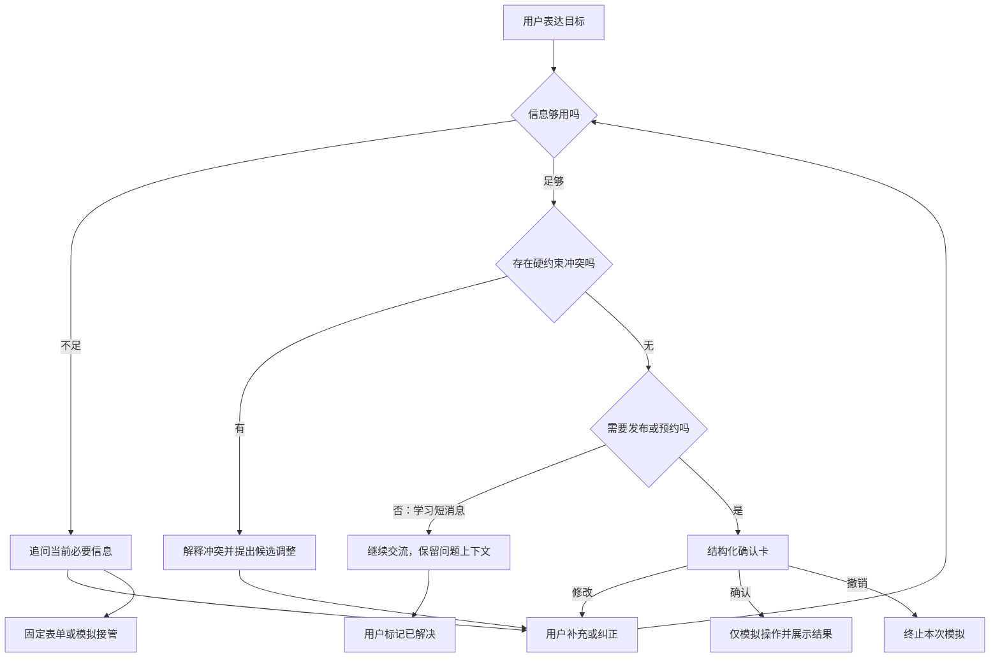

# 05 对话、卡片与抛弃式交互

对话负责表达与澄清，卡片负责需要明确约定的操作。卡片字段按本次约束变化；普通碎片学习问题保持对话，不为了统一版式强制发布表单。

## 1. 对话骨架

## 2. 十组演示脚本

“助手”台词是交互设计；原型有限规则的具体措辞以页面为准。本文不声称真实 AI 已产生这些内容。

### E01 行动不便

1. 用户：脚受伤、三个快递、北门驿站，今晚送到宿舍楼门口。
2. 助手：请确认你能接收且对方能识别的位置，以及交接方式。
3. 用户：在5号楼门口由室友协助当面接收，21:00—21:30，用站内消息，静默通知。
4. 结构化补充本次搬运/接收限制；确认卡展示校区、件数、地点、时段与联络。
5. 用户检查后确认；页面只显示模拟结果。不能宣称真的已送达。

### E02 上课中

1. 用户：21点后当面，上课期间静默。
2. 助手：补交接点、联络方式；请确认最晚取件时间。
3. 用户：驿站20:30截止，交接21:00—21:30。
4. 风险卡显示冲突；用户可调整窗口，或选择提前取件并填写确认过的临时存放点。
5. 未解决冲突确认按钮不可用；不自动认定驿站能代存。

### E03 新生认路

1. 用户：北门取一个快递，但不知道校区。
2. 助手：哪个校区？请查取件通知的驿站名称。
3. 用户：纠正为仙林校区北门驿站，选双方能识别的公共交接点。
4. 地点字段从待补充变为用户填写；原型没有地图或自动路线规划。
5. 继续确定时间、方式与通知，才能确认。

### E04 跨语言沟通

1. 用户：需要中英双语确认，当面交付。
2. 页面显示当面 / In person、指定点放置 / Drop-off、确认 / Confirmation 标签。
3. 用户纠正具体交接点和时段，校区/地点仍保留用户输入。
4. 确认卡展示同一组结构化事实；本阶段不提供完整实时翻译。

### E05 个性化交接

1. 用户：放在某个地点。
2. 助手：需要具体位置和放置后的确认方式。
3. 用户：填写5号楼一楼指定置物架，21:00—21:30，普通通知，照片后由我确认。
4. 放置卡展示位置与完成确认；用户可选择当面交付，位置被清空后重新确定，联络字段出现。
5. 变更后旧确认失效；模拟确认后也可再修改并重新确认。

### L01 基础薄弱

1. 用户：导数与极限的关系没明白，不知道从哪里开始。
2. 助手：你对哪一部分有印象？从必要基础开始，还是用一个例子？
3. 用户选择讲解起点；继续以短消息澄清，不填写完整学习档案。
4. 用户理解后可标记解决；如需要同学协助再模拟发布。

### L02 时间紧张

1. 用户：只有20分钟，链式法则没明白。
2. 助手：先解决哪个问题？
3. 用户：先弄明白为什么乘内层导数。
4. 保留20分钟和优先问题；20分钟是时长，不能代替预约时间。

### L03 时空受限

1. 用户：只能在线异步，没有整块时间。
2. 保存主题与异步方式，继续短消息；可以补期望回复节奏。
3. 用户主动选择发布时出现确认卡；主动选择实时预约时才增加明确时段。
4. 返回“继续短消息”后不再要求预约字段。

### L04 跨语言解释

1. 用户：希望中英双语解释链式法则。
2. 助手设计：具体是定义、识别，还是哪一步？
3. 用户补充同一个问题上下文，页面保留语言选择和术语提示。
4. 原型只演示语言约定与沟通过程，不生成真实数学答案。

### L05 碎片小问题

1. 用户：第二步到第三步怎么来的？
2. 助手：把这两步表达式贴出来就好。
3. 用户：第二步 y = -cos x；第三步 y′ = sin x。
4. 用户：再慢一点，只想知道符号变化。
5. 页面保留之前表达式与消息，不重新索取课程、预算、校区或预约时间；用户可标记解决。

## 3. 卡片与组件

| 组件 / 卡片 | 出现条件 | 允许动作 |
| --- | --- | --- |
| 情境样本入口 | 始终可见，按业务显示五个 | 载入样本；已有消息时提示清空 |
| 消息对话 | 两种业务均可使用 | 追加、纠正、保留上下文 |
| 交接方式比较 | 快递 | face/drop；不展示虚构人员候选 |
| 必要字段补充 | 根据业务和动作计算 | 用户填写，来源可见 |
| 约束风险 | 时间冲突、无效件数/窗口 | 调整输入或明确暂存方案 |
| 确认卡 | 快递或学习发布/预约 | 按当前 revision 确认；未就绪禁用 |
| 轻量学习区域 | 学习 conversation | 继续消息、用户标记解决 |
| 结果 / 进度状态 | 已确认、撤销、解决、模拟接管 | 显示模拟结果；已确认可重编辑 |
| 固定表单 | 用户主动打开 | 识别失败时直接补字段，不丢已有上下文 |
| 模拟接管摘要 | 用户主动选择 | 展示业务与缺口数量，明确无真实人工队列 |

原型使用预定义 Vue 模板和字段定义。机器可读卡片清单见 [ui-contract.json](./ui-contract.json)，用于设计对照；这不是已经实现的模型 Schema Renderer，正式白名单与服务端 Action 校验留到 M2。

## 4. 交互结束与降级

临时卡片随 session 结束或刷新失效。因为本阶段没有真实业务，撤销仅终止模拟；未来已经发布/接单的业务取消必须走受控工具与补偿规则。规则无法识别用户语言时保留原消息、允许手动填写；不显示“已理解所有内容”。

原型具备表单标签、焦点提示、键盘发送（Ctrl/⌘+Enter）、禁用状态、动态消息提示与移动端排布。尚未开展读屏用户试用，不报告完整无障碍认证。
