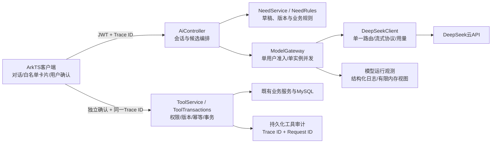

# 第一步：架构边界与观测基础

## 从M2接续的实际结构



这里的Agent是受限的对话编排，并非无限循环自动执行的代理。业务本体落实在字段目录和确定性规则中。第一步没有RAG索引或仓颉组件；第二步现已接入仓颉只读投影，见[双语言组件](./03-双语言任务模型与仓颉组件.md)。

## 本轮实现

1. 从控制器抽出`ModelGateway`，保留原有最多4并发、每用户1个的行为。容量只允许1—4，满载立即拒绝；数据库写入失败或线程池停止时归还准入，关闭同一租约不会重复释放。
2. 客户端生成随机`X-Campus-Trace-Id`，一次登录使用过程中的请求带同一编号；退出时更换。它是诊断关联标识，不决定身份、资源权限或工具幂等。
3. 服务端只接收UUID格式的关联编号，否则重新生成；每个HTTP请求另生成`X-Request-Id`，忽略调用方试图指定的Request ID。两者在响应头返回；异步模型线程显式传递并恢复上下文，避免线程池串号。
4. HTTP结构化日志记录路由模板、状态、耗时与两个编号。模型记录模型/Prompt版本、总耗时、首段文字耗时、SUCCEEDED/FAILED/CANCELLED和Token统计，不记录对话内容或供应商错误正文。
5. 为工具审计新增可空`trace_id`、`request_id`：准备、成功、撤回及独立事务中的拒绝/失败都带调用上下文。旧审计保留NULL，不补造历史追踪。
6. `/api/ops/model-observations`仅允许数据库角色ADMIN。当前JWT只含用户ID，因此在服务端重新读取角色；普通账号不能查看全局观测，也不能通过自填角色头获得权限。

## 计量边界

- 模型“成功”表示供应商返回完整可解析的回复；后续建议校验失败、草稿版本冲突、浏览器断开或工具业务失败仍须分别查证。HTTP200的SSE也可能包含failure事件。
- `firstTextMs`是模型请求开始到首段非空文字的耗时，不是客户端首屏耗时，也不是每Token间隔；纯工具建议时可为NULL。
- 用量来自供应商响应，缺失/无效为NULL；失败/取消记录用量未知，可能仍收费。没有按文本长度猜Token。
- 管理员视图只保留最近200次模型调用；累计数覆盖本进程生命周期，重启归零。结构化日志可落盘，但未部署日志轮转/集中收集；不是持久化计费系统。
- 当前是客户端到Java异步调用及工具审计的关联追踪；没有宣称供应商内部trace、OpenTelemetry spans或多机时钟一致性。

## 启动、查询与数据库升级

继续使用项目现有私有配置和启动器：

```bash
python3 scripts/dev-backend.py
```

迁移004前备份目标库，先应用001—003，再执行`database/migrations/004_tool_observation_ids.sql`。脚本只增加两列，允许重复执行；不要运行早期清库脚本。当前开发仍用JPA update，生产受控迁移留到部署步骤。

自有已登录客户端可指定UUID格式`X-Campus-Trace-Id`，在响应头核对`X-Request-Id`，再从本人`/api/trusted-tools/audits`查对应条目。运维观测接口需要真正ADMIN账号；不为演示公开管理员密码或将普通账号提权。

可离线复核新增规则，不调用付费模型：

```bash
cd backend
mvn -B -Dspring.profiles.active=test \
  -Dtest=ModelGatewayTest,DeepSeekClientTest,RequestTraceIntegrationTest,ToolIntegrationTest,AiIntegrationTest test
```

完整后端测试使用`mvn -B -Dspring.profiles.active=test test`；必须Java21。鸿蒙沿用`harmony/README.md`的DevEco构建与设备测试流程。

## 本轮证据与后续

Java21完整后端254项通过；API26模拟器29项通过，设备真实工具审计匹配客户端Trace ID，并验证退出更换编号。主包与测试包构建、安装成功。004迁移前已保存权限600的本地备份，重复执行两次，前后用户/任务/审计行数一致；真实HTTP另核对普通账号观测接口403与工具拒绝审计422。本轮未发付费模型请求，Token解析来自本地HTTP供应商替身测试。交付日志副本去除了终端颜色和行尾空格，测试结果及时间保留；原始日志保留于本机/tmp/campus-m3-step1-*。

实际运行结果见[evidence/01-step1-summary.json](./evidence/01-step1-summary.json)、[后端测试汇总](./evidence/01-backend-test-summary.json)、[增量迁移记录](./evidence/01-mysql-migration.json)。本轮修正过一条测试夹具：负revision由Bean Validation返回400，应使用合法但过期的revision验证409及准入释放，没有修改业务规则绕过校验。

[模拟器连接截图](./evidence/01-client-connected.png)仅展示原有草稿页正常恢复，不把它说成新增监控页面。

后续双语言实现与仓颉组件已在[第二步](./03-双语言任务模型与仓颉组件.md)完成本机验证。后续必须实做模型全程超时、限额/熔断、可重复部署与SLO/故障注入；本轮不把这些记为完成。
