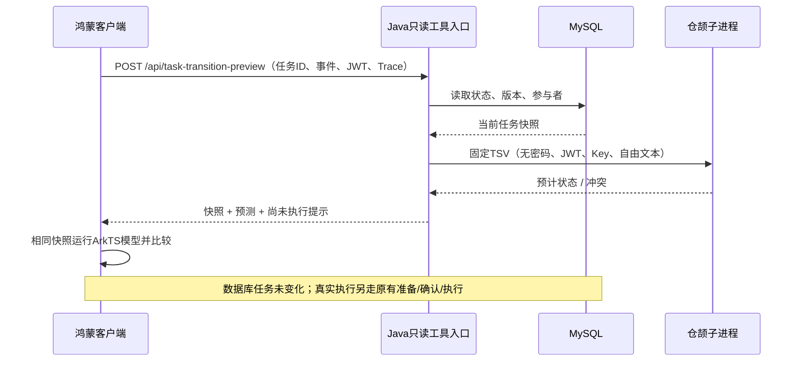

# 第二步：双语言任务模型与仓颉并发组件

> 阶段记录：测试数量和截图按当时运行保留。2026-10-29的当前结论、按钮与运行方式见[评审总览](./08-评审总览.md)和[现场脚本](./09-现场演示与变化挑战.md)。

对应课件第11页：同一模型用ArkTS与仓颉实现，制作可被AI原生应用调用的小型工具/事件组件，并用测试或性能数据解释价值。当前覆盖四业务共同任务状态，不改变M1的四业务范围。

## 交付物

| 交付 | 位置 | 用途 |
| --- | --- | --- |
| 模型与进程协议 | [transition-v1](../../contracts/task-transitions/README.md) | 状态、事件、参与者、范围、版本与重放语义 |
| ArkTS模型 | `harmony/entry/src/main/ets/domain/TaskTransitions.ets` | 客户端状态投影与回执核对 |
| 仓颉工程 | [源码与构建说明](../../cangjie/task-preview/README.md) | 固定协议、并发worker、原子分配及锁保护 |
| Java桥 | `backend/src/main/java/com/example/campushelp/transition/` | 真实数据快照、身份推导、准入/超时/输出限制 |
| 共同样本 | `harmony/entry/src/main/resources/rawfile/task-transition-cases.tsv` | 两边读取相同240行用例 |
| 语言选型ADR | [ADR-002](./04-双语言选型ADR.md) | 比较类型、并发、错误、工具链与实际代价 |
| 证据 | [第二步汇总](./evidence/02-step2-summary.json) | 构建、测试、组件和数据库实测 |

## 已接通的链路

预览API需要登录。等待接单任务允许登录用户预览；已接单/终止任务仅参与双方可预览。请求不接收由调用者指定的状态、版本或参与身份。新入口只读，没有新增数据库表或迁移。

JSON请求示例：`{"demandId":17,"event":"CANCEL"}`。返回engine、source、participant、event、decision及尚未执行提示。支持ACCEPT/SUBMIT/CONFIRM/CANCEL的有限状态投影；当前客户端按钮只用于接单与取消，尚未在UI补交付/完成的新流程。

## 实际验证

- 仓颉1.2.0编译与cjpm build均成功，SDK下载SHA256与官网一致，SDK和二进制不进Git。
- 四分类×五状态×四事件×三身份共240个共同用例，两边实际读取同一个文件；另测生命周期、过期版本、终态、整数上限、重复/冲突ID、跨任务隔离和调用者修改对象。
- 仓颉四worker并发128个相同事件：一次推进、127次重放。SERIAL/PARALLEL各12轮，每轮512个不同事件争同一版本：均一次推进、511次版本冲突。具体耗时见原始样本，不宣称并发必然更快。
- Java21完整后端262项通过；API26常规Hypium33项通过，含四项新模型测试和真实HTTP预览。240个样本集中在一项Hypium测试中，不把它计成240个独立设备测试。
- 实际MySQL接口测试：另一用户预览接单预计IN_PROGRESS；发布者预览取消预计CANCELLED；发布者预览接自己的任务被状态/角色规则拒绝。三次预览后真实任务均为PENDING、行版本0、无接单者。
- [真实页面截图](./evidence/02-native-transition-preview.png)来自“取消任务 → 填入测试编号 → 预览状态变化”操作；随后再次查询数据库，仍为PENDING/0/无接单者。截图中的CANCELLED是预测。
- 进程级停用组件后，预览真实返回503，原可信工具仍可准备并撤回同一测试任务的接单确认卡；恢复组件后预览成功。单测另验证挂起进程超时被终止、槽位释放、输出超限和损坏结果拒绝。
- 测试数据来自本机隔离campus_m2_dev；HTTP夹具用既有创建接口建立，明确不是AI发布样本。验证后用独立、明确确认的取消工具清理测试委托，保留历史审计。本轮没有付费模型调用或真人访谈。

## 复核与现场演示

1. 先执行`python3 scripts/build-task-preview.py`及`python3 scripts/verify-task-preview.py`。
2. 启动`python3 scripts/dev-backend.py`；开发启动器找到默认SDK和编译产物才启用组件。其他部署用TASK_PREVIEW_BINARY/TASK_PREVIEW_RUNTIME明确配置。
3. 当前新版在“任务”页选择任务，点“了解并接单”或“管理这次互助”，再点“查看影响”。早期截图的按钮文案为“预览状态变化（不执行）”。不需要发模型请求。
4. 对照界面的原状态与预测状态，再刷新真实任务列表；它不会因为预览而改变。
5. 真正执行仍需点击准备确认卡、核对、再明确执行；窗口、信用、权限和版本由原工具重新检查。

可重复的本地夹具脚本为`scripts/review-task-preview.py`：首次`setup --exercise-outage`创建两个私有测试账号和一个任务，后续`check-ui`核对状态，`cleanup`单独取消。私有状态保存在/tmp，已有状态时拒绝重新创建；不能对生产库使用，也不要删除状态后反复制造账号。

## 修正与边界

初版spawn捕获可变cursor被拒，改原子计数；一次cjpm检查缺少PATH内cjc，补子进程环境后成功；测试包漏导入TaskSummary，补齐后重新构建；中文响应断言最初按默认字符集读取而失败，改UTF-8，未放宽业务规则。早期失败日志留在本机/tmp中，最终证据只标真实最终结果。

本轮未完成Linux/云部署、真实业务迁移到仓颉、分布式去重、完整成本预算、模型全程超时/熔断或整体SLO。下一步继续模型网关的可靠性与成本约束。

旧阶段的`review-task-preview.py`按3307开发配置编写，保留作历史复核。当前3308/8081环境使用`review-m3-demo.py`及现场脚本中的私有配置；不要直接对另一个端口/数据库重做旧setup。第四步已完成Linux arm64构建和运行验证，第五步已完成有界容量/故障实验。
