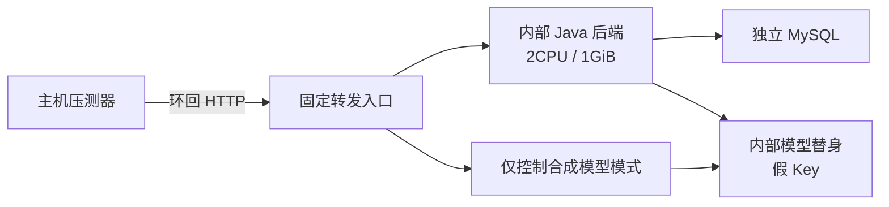

# 第五步：容量、SLO与故障演练

本轮实验于2026-10-28至29日完成。对应课件第13页的成本预算及第14页的容量、SLO、模型超时、工具重复调用和流式中断；课件没有指定并发数或P95数值，以下档位与目标由本项目设定。

本机单实例通过了所声明的有界实验。没有据此宣称公网、长期可用率、真实模型高并发或生产容量达标。

## 1. 实验环境与边界

- 被测后端为第四步的Linux arm64镜像`sha256:434828089c11c191da5e6b40032b59c48e2e1bb22a01bc86d6089bce102cbef1`，Java21、2CPU/1GiB、MySQL8.0.46（1CPU/512MiB），连接池上限8。运行制品来源沿用[第四步清单](./evidence/04-current-release-manifest.json)，不是在本步骤重新构建的Jar。
- 独立项目`campus-m3-capacity`、独立空库及10个合成账号。一个操作员账号只在该隔离库设置为ADMIN以读取观测；没有变更开发/真实用户的角色。
- 后端、数据库和模型替身仅连内部网络；一个不挂密钥的固定TCP入口分别转发至指定后端和替身控制接口，主机只开放环回18084/18766。后端没有可出网的网络和真实模型Key。替身只接受`fixture-only-key`，拒绝其他凭据。
- Python替身镜像固定digest；固定返回20段内容，每段间隔约25ms，usage的20输入/40输出Token是人为设定的计量样本，不能当作真实模型生成速度。
- 应用模型并发4、每账号并发1，满载立即拒绝，不排队。超时实验使用5秒模型截止时间、1秒熔断冷却；正常配置仍为45秒/30秒，不能把本轮5秒结果当成默认45秒配置的实测。
- 52次正常负载分三档闭环波次，3次预热不计入分布；不是持续小时级稳态负载。所有原始结果保留，包括两次准备失败。压测脚本在工作区运行后才提交，报告里的sourceCommit是当时起点b453ce5，不能把新脚本说成已包含在该旧提交中。



## 2. 指标和事先声明的本地目标

统计从HTTP发出开始，以单调时钟计时。首段文字是接收到第一个非空`text_delta`；完成必须同时满足HTTP200、`done.complete=true`、没有failure。只收到HTTP200、会话快照或半段答案均不算成功。成功流另查数据库确认USER/ASSISTANT已保存。

P50/P95采用nearest-rank，不插值、不把缺失用量或延迟记为0；原始样本在[JSONL](./evidence/05-capacity/samples.jsonl)。下列本地目标在正常样本运行前已写入report.json：

| 指标 | 适用范围 | 本地目标 | 结果 |
| --- | --- | --- | --- |
| 首段文字P95 | 替身正常对话，1/2/4并发 | <1000ms | 三档通过 |
| 完成P95 | 同上 | <3000ms，0次失败 | 三档通过 |
| 满载拒绝P95 | 4路占满后的额外请求 | <1000ms，且不调用上游 | 7.079ms，0次额外上游调用 |
| 满载时健康响应P95 | 20次readiness检查 | <1000ms | 2.322ms |
| 模型挂起终止 | 本轮5秒截止配置 | <6500ms，失败不保存完整答案 | 3次均在5024—5029ms终止 |

这些是本地实验验收线。真实DeepSeek样本不套用替身的1秒首段目标；设备渲染时间、公网TLS/代理、长期可用率未计入。

## 3. 正常并发与背压结果

| 同时对话数 | 样本 | 首段P50 / P95（ms） | 完成P50 / P95（ms） | 成功 / 失败 | 已核验操作/s |
| --- | --- | --- | --- | --- | --- |
| 1 | 12 | 20.825 / 25.439 | 549.344 / 603.604 | 12 / 0 | 1.764 |
| 2 | 16 | 22.771 / 28.867 | 551.749 / 564.039 | 16 / 0 | 3.575 |
| 4 | 24 | 24.023 / 65.746 | 539.834 / 573.982 | 24 / 0 | 7.140 |

操作/s使用波次墙钟时间，包含每次完成后的持久化GET复核；SSE延迟分布只计流请求本身。52/52只是本窗口观察，不能推导月度99.9%可用率。

4路对话占满后再发4路，额外4路全部HTTP429，且没有写入它们的用户消息、没有触达上游。若把这8次到达合并计算，成功率就是50%，不能把预期拒绝从用户体验中隐去。选择立即拒绝是在当前4槽上限下保护系统，并非证明可以服务8路。

满载期间，其他账号保存固定表单所用的草稿接口约11.252ms，健康检查P95约2.322ms；任务工具也能执行。这些是HTTP接口耗时，不含原生页面点击、输入或渲染。不是说正在流式回复的同一用户可以绕过客户端的编辑锁。

同机仍运行原演示部署，未独占宿主；CPU限额不是核资源预留。23个后端资源快照中，观察到内存最高约348.6MiB、CPU最高198.52%（接近2核限额）、进程/线程计数最高41。Docker采样离散且包含预热/故障/重启，不证明还有固定比例余量，也不能排除采样间峰值。未以本机整体内存冒充应用限制。

## 4. 必须实际演练的故障

| 场景 | 实际注入与判定 | 结果 |
| --- | --- | --- |
| 账号重复对话 | 同账号不同会话并发 | 后一次429，显式取消前一次后可继续 |
| 模型超时 | 先输出一段，之后仅发供应商注释心跳 | 5秒全程截止仍生效，3次TIMEOUT；仅保留USER，无伪造完整回答 |
| 熔断与恢复 | 连续3次超时后再调用 | HTTP503、无上游请求；冷却后恢复 |
| 供应商限流 | 注入上游429 | SSE failure=UPSTREAM_RATE_LIMIT，没有done，不自动重试 |
| 流式正文中断 | 有首段但缺失结束帧 | failure=INVALID_RESPONSE，没有done；后续正常请求成功 |
| 客户端断线 | 收到首段后关闭HTTP，不发显式取消 | 本次约73.743ms内账本进入CANCELLED；不能推广为任意网络均瞬时发现 |
| 缺少usage | 完整响应不返回usage | 操作成功，但估价NULL/USAGE_UNKNOWN，预留额度仍消耗，不记作免费 |
| 并发名额恢复 | 故障后再同时发4路 | 4路全部成功，无遗留占槽 |
| 同一工具重复执行 | 模型4路占满时，8并发共48次确认同一取消回执 | 同一合成任务全部得到SUCCEEDED；只有1条成功执行审计，信用只减5分 |
| 越权工具调用 | 非拥有者执行该回执 | HTTP404，未得到他人回执或执行权限 |
| 后端重启 | 保留原JWT和数据库后重启进程 | JWT、额度与成功回执保留，重放不重复扣分，模型仍可用 |

模型替身共收到79次请求，另有6次在模型准入处被拒绝；48次工具重放单独计量。故障/取消/缺失usage共8条费用未知记录，没有把它们混入正常52条或记作零费用。所有本地替身请求实际外部收费为0。

断线恢复采用重新加载已保存的上下文后由用户继续或退回表单；没有实现逐Token断点续传，也不自动重发可能收费的请求。替身的注释心跳用于验证活跃连接仍受截止时间约束；当前应用下行尚无独立周期心跳，本轮没有声称完成公网长连接保活或长时间浸泡测试。

## 5. 两次真实模型小样本与Token/s

2026-10-29单独在原Mac开发服务8081上顺序调用两次DeepSeek；不使用上述隔离压测库，不做并发压力，无自动重试，无发布/付款，任务数量不变。它和Linux容器实验的环境不同，不能直接合并统计。

| 场景 | 首段文字（s） | 完成（s） | 输入 / 输出Token | 输出Token / 整次请求秒数 | 峰值快照估价USD |
| --- | --- | --- | --- | --- | --- |
| 学习负号问题 | 3.401 | 4.303 | 1276 / 99 | 23.006 | 0.00050160 |
| 借用需求整理 | 1.976 | 1.988 | 1583 / 241 | 121.204 | 0.00076410 |

Token来自供应商usage，经持久账本读取，没有按中文字数猜测。上表Token/s分母包含网络、输入处理及工具参数生成，输出Token也可能包含工具参数；它不是GPU纯解码速率，更不是设备文字显示速率。两个单样本不足以报告真实服务P95或稳定吞吐量。

另用同样替身对照输出策略：学习网关首段4ms、用户HTTP首段14.243ms；借用网关首段同样4ms，但经建议校验后用户摘要首段547.813ms。借用的原模型过程文本不会透出，不能拿4ms冒充用户已看到整理结果。真实两样本的时序差异也不代表某业务总比另一业务快。

原始输入、回复、用量与时序在[真实抽样记录](./evidence/05-capacity/live-model.json)，不是虚构用户反馈。

## 6. 成本容量与预算判断

2026-10-29再次核对[DeepSeek官方价格](https://api-docs.deepseek.com/quick_start/pricing/)：deepseek-flash峰值每百万Token的输入命中/未命中/输出为USD0.006/0.30/1.20，仍与现有20261024峰值快照一致。采用峰值估价，不自动应用时段折扣；供应商账单尚未对账。

两次真实样本峰值估价合计USD0.00126570。不能把这个小样本均值当成所有长上下文任务的成本，也不能把USD0.04316160的两次保守预留说成实际花费。缓存收益未做重复付费请求评估，未知usage继续保守占用预留。

每次预留`65536输入×0.30/百万 + 1600输出×1.20/百万 = USD0.02158080`。当前平台次数上限100/日、预留预算USD2/日同时生效，因此有效保守上限是`floor(2 / 0.02158080)=92次派发/日`，不是保证100次；单账号20次/日先触发其次数限制。50次派发会预留USD1.07904，92次为USD1.98543360，均不是账单。

这解释了“瞬时能同时4路”和“每天能发多少次”是不同约束。若课程演示需更多账号，先核算真实预算、上下文长度及可接受拒绝率，不能只增并发或关闭额度。无模型时保留规则、表单、已参与任务的真人消息与可信工具；当前不自动切换到另一家付费模型。

## 7. 面向后续部署的候选SLO

在本地验收之外，提出后续低流量试运行目标：已准入且非用户取消的请求完成率≥99%，学习HTTP首段P95≤5秒、整次完成P95≤15秒；需求类以可核对摘要/卡片到达为首个有效结果。模型准入拒绝率另计、正常预算范围内目标≤5%，不能从总体失败中静默剔除；健康与固定表单需独立可用。

以上均为候选目标，尚未通过真实模型足量样本、长时间窗口、云端代理或真人试用验证。还需下行保活、上下文长度分档、长连接浸泡、持续到达负载、代理断流、跨节点限流与成本对账；不在本轮补造数据。工具副作用重复数必须为0，该不变量本轮48次重放已实际验证，但未证明任意故障下都不会出错。

## 8. 证据与复现

[原始报告](./evidence/05-capacity/report.json)、[逐请求样本](./evidence/05-capacity/samples.jsonl)、[核验汇总](./evidence/05-capacity/summary.json)、[证据索引](./evidence/05-capacity/README.md)。压测器、替身、固定入口、统计器和独立核验器均为Python标准库，不要求安装压测平台。

```sh
# 使用新的受限实验名和输出目录；本轮已完成证据不覆盖。
python3 scripts/review-capacity.py --project campus-m3-capacity-demo --output /tmp/campus-capacity-demo init
python3 scripts/review-capacity.py --project campus-m3-capacity-demo --output /tmp/campus-capacity-demo up
python3 scripts/review-capacity.py --project campus-m3-capacity-demo --output /tmp/campus-capacity-demo run
python3 scripts/review-capacity.py --project campus-m3-capacity-demo --output /tmp/campus-capacity-demo down
# 已有证据可离线核验，不调用模型。
python3 scripts/verify-capacity-evidence.py docs/M3/evidence/05-capacity
```

完整报告不允许盲目重跑；部分报告需查看失败后显式`run --resume`，已完成阶段跳过，原样本和失败保留。初始化和账号准备曾分别因内部网络不发布端口、合成密码超过原有20字限制失败，均未发出模型请求；修正后沿用同一环境，没有清库或伪造初次成功。后端/鸿蒙源码本轮未修改，沿用第四步289项与用户版36项历史结果；本轮实际新增/重跑的是16项Python检查、真实HTTP实验和两次模型抽样。
