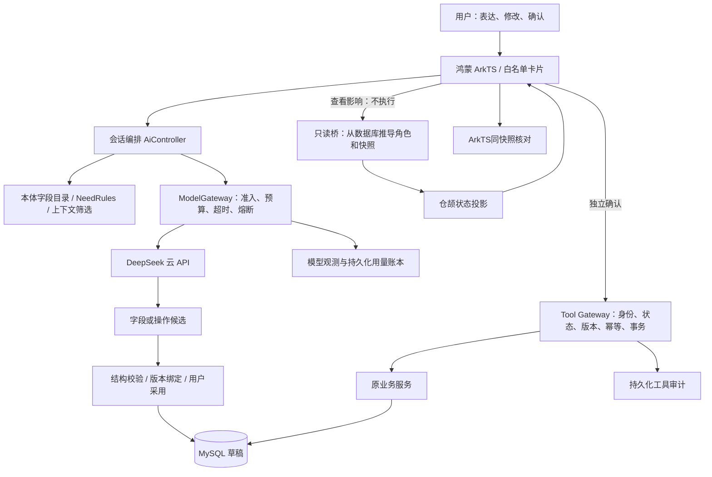

# M3评审总览：从对话到可控、可追踪的执行

日期：2026-10-29。状态：本机版本与评审材料已准备；教师评审、云端和长期运行验证尚未发生。01—07是各阶段原始记录，本页作为当前状态入口。

## 做出了什么

在老师项目的Java/MySQL业务底座上，实现鸿蒙客户端中的四业务需求澄清、可修改卡片和用户确认；M3补上模型准入、费用预留、故障控制、双语言只读组件、部署恢复与实测证据。模型只提出候选，可信业务服务决定是否执行。

业务范围保持跑腿代办RUNNING、学习辅导STUDY、物品借用BORROW、其他互助OTHER。原团队的注册、任务、信用、聊天等是继承成果；新增升级与证据按本仓库提交和M1/M2/M3记录区分，不用原P0—P4测试数代替本轮结果。

## 课件要求与交付位置

| 课件位置 | 要求 | 当前实现与证据 | 范围 |
| --- | --- | --- | --- |
| 第11页，W8 | 同一模型用ArkTS与仓颉实现，比较类型/错误/工具链 | [共同契约](../../contracts/task-transitions/README.md)、[两种语言及240样本](./03-双语言任务模型与仓颉组件.md)、[选型ADR](./04-双语言选型ADR.md) | 四业务共同任务状态模型；不重复实现全部业务 |
| 第11页，W9 | 可调用的仓颉并发组件，测试或性能解释价值 | 仓颉4 worker、原子分号和互斥投影；128同ID请求一次推进；[Mac复核](./evidence/06-review/cangjie-recheck.json)、[Linux240样本](./evidence/04-cangjie-linux.json) | 当前为应用按需调用的只读预览；没有让LLM自动执行此组件 |
| 第12页，W10 | 编排、模型、知识规则与可信工具分层 | [架构与追踪](./01-架构边界与观测基础.md)，下图及代码映射 | 业务知识使用本体字段目录/确定规则；未部署向量RAG |
| 第13页，W11 | LLM部署ADR、路由和成本预算，说明数据去向 | [部署与路由ADR](./02-模型部署ADR与路由策略.md)、[预算与出域规则](./05-模型网关可靠性与额度.md)、[真实Token与估价](./07-容量SLO与故障演练.md) | DeepSeek云API单一路由；本机后端并不等于已上云 |
| 第14页，W12 | 容量、SLO、模型超时、工具重复和流式中断 | [完整实验](./07-容量SLO与故障演练.md)、[原始数据与独立复算](./evidence/05-capacity/README.md) | 本机有界验收通过，生产SLO仍为候选 |
| 第14页 | 高可用、降级、工具可靠性和观测 | [重启/备份/回滚/恢复](./06-可重复部署与恢复.md)，UI表单回退与工具独立确认 | 单实例恢复演练，不是多节点高可用 |
| 第21—22页 | 现场运行、解释设计和处理变化，提供证据 | [演示脚本](./09-现场演示与变化挑战.md)、[最终核对](./10-交付检查与后续.md)、[本轮排练](./evidence/06-review/README.md) | 合成数据排练；没有虚构真人或教师反馈 |

课件没有规定必须使用Docker、Flyway、4并发或某个P95数值。这些是实现选择；通过条件与未覆盖项见对应记录。

## 当前架构与信任边界

| 层 | 代码入口 | 关键约束 |
| --- | --- | --- |
| 对话与展示 | `harmony/entry/src/main/ets/pages/Needs.ets`、`ui/CardProtocol.ets` | 四业务共用入口；学习小问题不强制发布；白名单控件，不执行模型代码 |
| 编排与知识 | `ai/AiController.java`、`domain/NeedRules.java`、`resources/domain/need-fields.json` | 当前类别最小上下文；缺失和冲突由规则检查；模型不猜授权 |
| 模型准入 | `ai/ModelGateway.java`、`DeepSeekClient.java`、`ModelBudgets.java` | 最多4路/每用户1路；持久预算；全程截止；无自动重试 |
| 可信工具 | `tools/ToolTransactions.java`、`ToolIntentRepository.java` | 服务端查身份/状态/版本；独立明确确认；同回执重放；事务与审计 |
| 双语言组件 | `transition/`、`cangjie/task-preview/src/`、ArkTS `TaskTransitions.ets` | 数据库快照决定输入；有限TSV，不传凭据或自由文本；只读、不代替业务授权 |
| 观测 | `observability/RequestTrace.java`、`ModelObservations.java`、工具审计 | Trace贯通异步调用；Request ID逐请求生成；运维接口ADMIN，诊断ID不是权限 |

Java路径均相对`backend/src/main/java/com/example/campushelp/`，resources位于`backend/src/main/`。

## 版本与运行环境

| 项目 | 当前值/入口 |
| --- | --- |
| 分支 | `feature/m3-agent-reliability` |
| Prompt | `campus-needs-v3-user`：面向用户的简短答案，任务整理在校验后输出摘要 |
| Context | `selected-category-last20-bounded-v1` |
| 协议 | `transition-v1`，共同整数范围0—2^53−1 |
| 仓颉 | 1.2.0；Mac arm64与Linux arm64已验证，amd64未实测 |
| 开发演示 | 鸿蒙模拟器 → 本机8081 → 原开发库3308/campus_m2_dev |
| 独立部署演练 | 环回18082 → Linux容器 → 独立MySQL8库，真实模型Key留空 |
| 压测演练 | 环回18084/18766，仅内部替身与独立库；实验后已停止并保留卷 |
| 配置 | 演示使用本机私有`.env.m3-demo.local`；模型Key仍从原私有配置读取，不在仓库/客户端/交付包 |

模拟器当前连8081。18082和18084各自有独立数据库，不能拿它们的任务编号到开发UI里查询。模型别名由供应商维护，版本记录不等于冻结模型权重。

## 最新证据怎样解读

- 后端最后全量289项通过；后续修正Linux巨行测试夹具，未改变生产限制。修复提交的[GitHub检查](https://github.com/PBpromax/campus/actions/runs/40828768212)四项通过。设备36项来自用户版界面阶段，本轮只排练具体页面，不把240共同样本算240个独立设备测试。
- 1/2/4并发共52次正常请求成功；故障、拒绝与预热分开统计。4槽满时另4请求被拒绝，所以这8次到达的成功率为50%；系统用背压保护自身，并没有承诺8路服务。
- 同一取消8并发共48次确认，1条成功执行审计、信用只扣5分。超时、断流、取消和重启均留有实际结果。
- 两次真实模型小样本均成功，峰值快照估价合计USD0.00126570；不是账单，不够计算真实服务P95。合成替身79次调用的实际外部收费为0。
- 平台USD2/日保守预算与每次USD0.02158080预留共同决定约92次派发/日；4路并发是瞬时约束，不能据此扩大日容量承诺。
- 本轮再次运行仓颉240样本及并发小实验，并在新版界面验证“查看影响”未接单；借用修改/时间冲突/确认失效/撤回串行排练通过，付费模型调用0次。

## 必须说明的边界

生产SLO、持续到达/长连接浸泡、应用下行周期心跳、公网HTTPS/SSE代理、真机、多人真实试用、账单对账和跨节点限流未完成。自由文本出域检查只覆盖有限模式；没有宣称完整脱敏、任意故障零丢失、自动补偿或自动切换模型。

当前可以参加本机评审：运行系统、解释架构选择、复算数据、现场修改约束并展示受限执行。是否满足教师最终验收，以现场评审为准。
